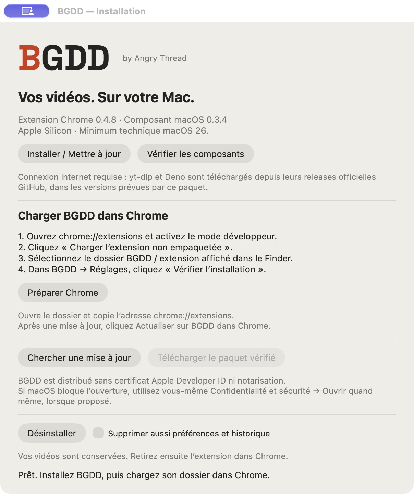

<picture><source media="(prefers-color-scheme: dark)" srcset="assets/wordmark-dark.svg"></picture>

<strong>Vos vidéos, dans leur meilleure qualité.</strong> by Angry Thread

Français · <a href="README.en.md">English</a>

BGDD est un logiciel **gratuit et propriétaire** qui associe une extension Chrome à un moteur local macOS. Choisissez une publication, un format et un dossier : le téléchargement et le traitement se font sur votre Mac. Aucun compte BGDD, abonnement, serveur de téléchargement ou télémétrie.

**Candidate 0.4.8-rc.2 en préparation privée.** Aucun téléchargement public n’est encore disponible. Cible : **macOS 26 et 27, Apple Silicon** ; consultez le [périmètre réellement validé](docs/DISTRIBUTION-VALIDATION.md). Intel n’est pas pris en charge.

Captures du véritable popup avec une publication de démonstration et un historique vide.

## Choisir son format

| Format | Résultat |
|---|---|
| Qualité maximale | Meilleurs flux accessibles, sans réencodage vidéo ; MKV si nécessaire |
| MP4 compatible | Flux H.264/AAC disponibles, sans transcodage ; résolution parfois inférieure |
| WAV | Export PCM 24 bits, fréquence et canaux de la source |
| MP3 | Débit natif lorsqu’un MP3 exploitable existe ; sinon conversion choisie, jusqu’à 320 kb/s |

YouTube, X, Instagram et TikTok ont des adaptateurs dédiés. TikTok propose aussi des carrousels MP4, images ZIP et exports audio. Le bouton **B** sur X lance la qualité maximale. L’accès dépend de la publication, de la région et des changements des plateformes ; aucun accès universel ou privé n’est promis. [Preuves et limites](docs/DISTRIBUTION-VALIDATION.md).

## Installer

L’installateur guide l’installation, le chargement Chrome et la maintenance.

1. Télécharger le DMG d’une release approuvée et ouvrir **BGDD Installer.app**.
2. Si macOS bloque l’ouverture, suivre **Réglages Système → Confidentialité et sécurité → Ouvrir quand même**, lorsque cette option est proposée, puis confirmer vous-même. BGDD est distribué **sans certificat Developer ID ni notarisation Apple**. [Guide Gatekeeper](docs/DISTRIBUTION-GATEKEEPER.md).
3. Choisir **Installer / Mettre à jour**, puis **Vérifier les composants**. Une connexion Internet est nécessaire : yt-dlp et Deno sont récupérés directement depuis leurs releases officielles, à versions fixes et après vérification d’intégrité.
4. Choisir **Préparer Chrome**, ouvrir l’adresse copiée, activer **Mode développeur**, puis **Charger l’extension non empaquetée** et sélectionner le dossier indiqué.
5. Dans BGDD, ouvrir **Réglages → Vérifier l’installation**.

Aucun Terminal, Homebrew, Python ou Node.js à installer. Le chargement Chrome est manuel et normalement destiné au développement ; il ne fournit pas les mises à jour du Chrome Web Store. [Guide détaillé](docs/DISTRIBUTION-INSTALL.md).

## Mettre à jour ou retirer BGDD

La recherche de mise à jour est volontaire, depuis l’installateur et ce dépôt de distribution. Vous choisissez le nouveau paquet après vérification de son intégrité, autorisez son ouverture si macOS le demande, puis **Installer / Mettre à jour**. Dans Chrome, cliquez **Actualiser** sur BGDD et rechargez les publications déjà ouvertes. Le dossier, l’identité, les préférences et l’historique sont conservés.

Pour retirer BGDD, supprimez l’extension dans Chrome, puis choisissez **Désinstaller** dans l’installateur. L’effacement des préférences natives est un choix explicite. **Les fichiers téléchargés sont conservés.**

## Limites et droits

Un téléchargement actif, une file de cinq tâches et 60 résultats d’historique. Fermer le popup laisse le transfert continuer ; fermer Chrome l’arrête sans reprise automatique. Aucun processus résident ni recherche périodique de mise à jour. APFS fournit une publication atomique exclusive ; sur l’exFAT observé, la copie finale exclusive est vérifiée et peut être visible pendant son écriture.

Le code original reste privé ; le JavaScript nécessaire à l’extension est inspectable, sans obfuscation agressive. Les [conditions BGDD](LICENSE-BGDD.txt) ne limitent pas les droits accordés sur les composants tiers. [Licences et sources](docs/DISTRIBUTION-LICENSES.md). Téléchargez uniquement les contenus que vous êtes autorisé à conserver.
