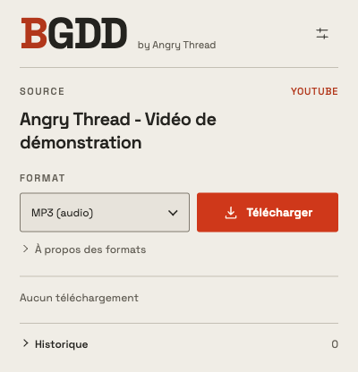
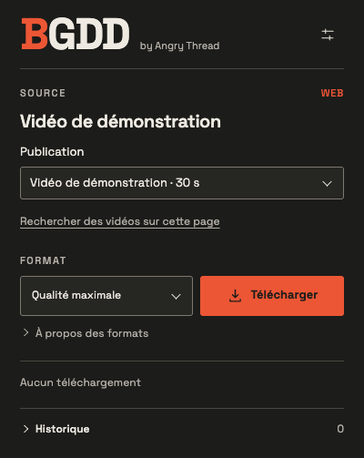

<picture><source media="(prefers-color-scheme: dark)" srcset="assets/wordmark-dark.svg"></picture>

<strong>Vos vidéos, en haute définition, sur votre Mac.</strong> by Angry Thread

Français · <a href="README.en.md">English</a>

BGDD est un logiciel **gratuit et propriétaire** qui associe une extension Chrome à un moteur local macOS. Choisissez une publication, un format et un dossier : le téléchargement et le traitement se font sur votre Mac. Aucun compte BGDD, abonnement, serveur de téléchargement ou télémétrie.

**Préversion 0.4.8-rc.7 — Apple Silicon et Intel.** [Notes de version](https://github.com/enrimerveille/BGDD-downloads/releases/tag/v0.4.8-rc.7).

| Votre Mac | Télécharger |
|---|---|
| Apple Silicon (ARM64), macOS 27 | [DMG Apple Silicon](https://github.com/enrimerveille/BGDD-downloads/releases/download/v0.4.8-rc.7/BGDD-macOS-arm64.dmg) |
| Intel (x86_64), macOS 26 | [DMG Intel](https://github.com/enrimerveille/BGDD-downloads/releases/download/v0.4.8-rc.7/BGDD-macOS-x86_64.dmg) |

## Choisir son format

| Format | Résultat |
|---|---|
| Qualité maximale | Meilleurs flux accessibles, sans réencodage vidéo ; MKV si nécessaire |
| MP4 compatible | Flux H.264/AAC disponibles, sans transcodage ; résolution parfois inférieure |
| WAV | Export PCM 24 bits, fréquence et canaux de la source |
| MP3 | Débit natif lorsqu’un MP3 exploitable existe ; sinon conversion choisie, jusqu’à 320 kb/s |

Les vidéos MKV peuvent nécessiter un lecteur compatible, comme VLC. Choisissez **MP4 compatible** pour faciliter la lecture.

YouTube, X, Instagram et TikTok ont des adaptateurs dédiés. TikTok propose aussi des carrousels MP4, images ZIP et exports audio. Le bouton **B** sur X lance la qualité maximale. L’accès dépend de la publication, de la région et des changements des plateformes ; aucun accès universel ou privé n’est promis.

## Installer

1. Ouvrir le DMG adapté à votre Mac, puis son unique application **Installer BGDD.app**.
2. Si macOS bloque l’ouverture, décider personnellement de l’autorisation dans **Réglages Système → Confidentialité et sécurité → Ouvrir quand même**, lorsque proposée. BGDD reste **sans Developer ID ni notarisation Apple**. [Guide Gatekeeper](docs/DISTRIBUTION-GATEKEEPER.md).
3. Suivre les quatre étapes : **Installer BGDD / Mettre à jour BGDD**, **Préparer le moteur**, **Ajouter à Chrome**, puis **BGDD est prêt**. L’aide et les licences sont intégrées.
4. Pour une première installation Chrome, activer **Mode développeur** et **Charger l’extension non empaquetée** depuis le dossier montré. Pour une mise à jour, cliquer **Actualiser** sur la carte BGDD existante, sans la supprimer.
5. Dans BGDD, ouvrir **Réglages → Vérifier l’installation**, fermer le popup, revenir à l’assistant et choisir **Vérifier la connexion**, puis **Terminer**.

Une connexion Internet est nécessaire à l’installation. Aucun Terminal, Homebrew, Python ou Node.js à installer. L’extension se charge manuellement ; elle ne se met pas à jour via le Chrome Web Store. [Guide détaillé](docs/DISTRIBUTION-INSTALL.md).

## Mettre à jour ou retirer BGDD

Recherchez les mises à jour depuis l’installateur. Ouvrez le nouveau paquet, puis choisissez **Mettre à jour BGDD** et **Ouvrir BGDD Engine**. Dans Chrome, cliquez **Actualiser** sur BGDD et rechargez les publications déjà ouvertes. Le dossier, l’identité, les préférences et l’historique sont conservés.

Pour retirer BGDD, supprimez l’extension dans Chrome, puis choisissez **Maintenance… → Désinstaller** dans l’installateur. L’effacement des préférences natives est un choix explicite. **Les fichiers téléchargés sont conservés.**

## Limites et droits

Un téléchargement actif, une file de cinq tâches et 60 résultats d’historique. Fermer le popup laisse le transfert continuer ; fermer Chrome l’arrête sans reprise automatique. Aucun processus résident ni recherche périodique de mise à jour. Les fichiers existants ne sont jamais écrasés. Sur un disque exFAT, attendez la confirmation de réussite avant d’ouvrir le fichier, qui peut apparaître pendant sa copie finale.

BGDD est gratuit et propriétaire. Les [conditions BGDD](LICENSE-BGDD.txt) ne limitent pas les droits accordés sur les composants tiers. [Licences et sources](docs/DISTRIBUTION-LICENSES.md). Téléchargez uniquement les contenus que vous êtes autorisé à conserver.
