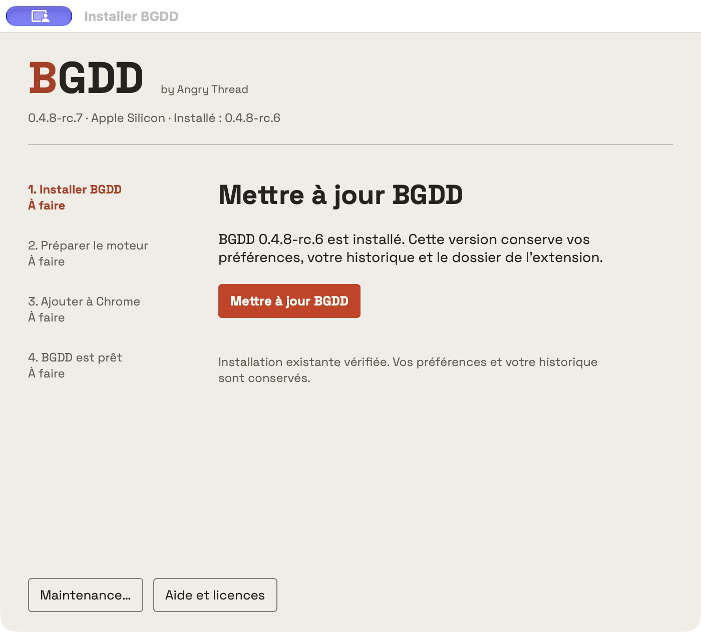

<picture><source media="(prefers-color-scheme: dark)" srcset="assets/wordmark-dark.svg"></picture>

<strong>Vos vidéos, en haute définition, sur votre Mac.</strong> by Angry Thread

Français · <a href="README.en.md">English</a>

BGDD est un logiciel **gratuit et propriétaire** qui associe une extension Chrome à un moteur local macOS. Choisissez une publication, un format et un dossier : le téléchargement et le traitement se font sur votre Mac. Aucun compte BGDD, abonnement, serveur de téléchargement ou télémétrie.

**Préversion commune 0.4.8-rc.7 — Apple Silicon et Intel.** [Release, empreintes et sources tierces](https://github.com/enrimerveille/BGDD-downloads/releases/tag/v0.4.8-rc.7).

| Votre Mac | Paquet | Validation |
|---|---|---|
| Apple Silicon, macOS 27 | [DMG ARM64](https://github.com/enrimerveille/BGDD-downloads/releases/download/v0.4.8-rc.7/BGDD-macOS-arm64.dmg) | Recette ARM ; macOS 26 ARM non qualifié |
| Intel x86_64, macOS 26 | [DMG Intel](https://github.com/enrimerveille/BGDD-downloads/releases/download/v0.4.8-rc.7/BGDD-macOS-x86_64.dmg) | Contrôles statiques RC.7 ; essais physiques antérieurs sous 26.5.2 réutilisés |

**La nouvelle interface RC.7 n’a pas été exécutée sur Intel.** Le fonctionnement Chrome antérieur est confirmé par le propriétaire ; aucune nouvelle session Intel n’est revendiquée. [Preuves et limites](docs/DISTRIBUTION-VALIDATION.md).

Captures du véritable popup avec une publication de démonstration et un historique vide.

## Choisir son format

| Format | Résultat |
|---|---|
| Qualité maximale | Meilleurs flux accessibles, sans réencodage vidéo ; MKV si nécessaire |
| MP4 compatible | Flux H.264/AAC disponibles, sans transcodage ; résolution parfois inférieure |
| WAV | Export PCM 24 bits, fréquence et canaux de la source |
| MP3 | Débit natif lorsqu’un MP3 exploitable existe ; sinon conversion choisie, jusqu’à 320 kb/s |

YouTube, X, Instagram et TikTok ont des adaptateurs dédiés. TikTok propose aussi des carrousels MP4, images ZIP et exports audio. Le bouton **B** sur X lance la qualité maximale. L’accès dépend de la publication, de la région et des changements des plateformes ; aucun accès universel ou privé n’est promis. [Preuves et limites](docs/DISTRIBUTION-VALIDATION.md).

L’installateur suit automatiquement l’apparence claire ou sombre de macOS, y compris pendant son utilisation.

Captures de la vraie fenêtre AppKit ; interface identique sur ARM et Intel, dont la qualification reste distincte.

## Installer

1. Ouvrir le DMG adapté à votre Mac, puis son unique application **Installer BGDD.app**.
2. Si macOS bloque l’ouverture, décider personnellement de l’autorisation dans **Réglages Système → Confidentialité et sécurité → Ouvrir quand même**, lorsque proposée. BGDD reste **sans Developer ID ni notarisation Apple**. [Guide Gatekeeper](docs/DISTRIBUTION-GATEKEEPER.md).
3. Suivre les quatre étapes : **Installer BGDD / Mettre à jour BGDD**, **Préparer le moteur**, **Ajouter à Chrome**, puis **BGDD est prêt**. L’aide et les licences sont intégrées.
4. Pour une première installation Chrome, activer **Mode développeur** et **Charger l’extension non empaquetée** depuis le dossier montré. Pour une mise à jour, cliquer **Actualiser** sur la carte BGDD existante, sans la supprimer.
5. Dans BGDD, ouvrir **Réglages → Vérifier l’installation**, fermer le popup, revenir à l’assistant et choisir **Vérifier la connexion**, puis **Terminer**.

Aucun Terminal, Homebrew, Python ou Node.js à installer. Le chargement Chrome est manuel et normalement destiné au développement ; il ne fournit pas les mises à jour du Chrome Web Store. [Guide détaillé](docs/DISTRIBUTION-INSTALL.md).

La candidate regroupe les exécutables dans BGDD Engine.app et distingue les erreurs du gardien de celles des outils. Les résultats de recette et les réserves de publication figurent dans [Validation](docs/DISTRIBUTION-VALIDATION.md). Le profil Chrome isolé ne constitue pas un Mac à l’historique Gatekeeper vierge.

## Mettre à jour ou retirer BGDD

La recherche de mise à jour est volontaire, depuis l’installateur et ce dépôt de distribution. Vous choisissez le nouveau paquet après vérification de son intégrité, autorisez son ouverture si macOS le demande, puis **Mettre à jour BGDD** et **Ouvrir BGDD Engine**. Dans Chrome, cliquez **Actualiser** sur BGDD et rechargez les publications déjà ouvertes. Le dossier, l’identité, les préférences et l’historique sont conservés.

Pour retirer BGDD, supprimez l’extension dans Chrome, puis choisissez **Maintenance… → Désinstaller** dans l’installateur. L’effacement des préférences natives est un choix explicite. **Les fichiers téléchargés sont conservés.**

## Limites et droits

Un téléchargement actif, une file de cinq tâches et 60 résultats d’historique. Fermer le popup laisse le transfert continuer ; fermer Chrome l’arrête sans reprise automatique. Aucun processus résident ni recherche périodique de mise à jour. APFS fournit une publication atomique exclusive ; sur l’exFAT observé, la copie finale exclusive est vérifiée et peut être visible pendant son écriture.

Le code original reste privé ; le JavaScript nécessaire à l’extension est inspectable, sans obfuscation agressive. Les [conditions BGDD](LICENSE-BGDD.txt) ne limitent pas les droits accordés sur les composants tiers. [Licences et sources](docs/DISTRIBUTION-LICENSES.md). Téléchargez uniquement les contenus que vous êtes autorisé à conserver.
